<p align="center">
  
</p>

# 🔋 ARMOR-NODE-SOLAR-HMI

<p align="center">
  🇺🇸 <b>English</b> |
  <a href="README_spa.md">🇪🇸 Español</a> |
  <a href="README_fra.md">🇫🇷 Français</a> |
  <a href="README_ita.md">🇮🇹 Italiano</a> |
  <a href="README_deu.md">🇩🇪 Deutsch</a> |
  <a href="README_zho.md">🇨🇳 简体中文</a> |
  <a href="README_jpn.md">🇯🇵 日本語</a> |
  <a href="README_por.md">🇵🇹 Português</a>
</p>

### The energy screen of the house: a 7-inch touch screen that will show the battery stacks, their cells and the inverters as ARMOR-SERVER knows them

<p align="center">
  
  
  
  
  
  
</p>

---

**Honesty check - what runs today:** The logic behind the screen and a simulator of an installation are written and tested on a computer (5 host programs). **There is no firmware, no screen and no connection to a server yet; nothing here sends an order to a battery, and nothing has run on a board.**

---

## 📋 At a glance

| | |
|---|---|
| Version | `0.0.1` |
| Maturity | Scaffolding |
| Role | Solar touch screen of A.R.M.O.R. (family: Clients, parent: ARMOR-SERVER) |
| Stack | C++17 core and simulator, CMake; Python checks |
| Tests | 5 host programs |
| Board | Guition JC1060P470C (ESP32-P4 with ESP32-C6, 7-inch 1024 x 600); not yet supported by code |
| Runs on | A computer with CMake, a C++17 compiler and Python 3.11+ |
| On real hardware | Nothing has run on the board |
| License | GPL-3.0-or-later |

**Jump to:** [Overview](#-overview) · [Architecture](#-architecture) · [Features](#-features) · [Security](#-security--safety) · [Quick start](#-quick-start) · [Testing](#-testing) · [Structure](#-repository-structure) · [Related](#-related-projects)

## 🚦 Project status

Each line is one part of this repository and the light says how far it is today. It is written from what the repository can show (tests, builds, runs), not from what is planned.

🟢 Done and verified · 🟡 Works, with known limits · 🟠 Partly done or not verified yet · 🔴 Not done or not working

| Area | State | What it means here |
|---|---|---|
| Software | 🟠 | The core that reads, judges and guards is written; the firmware is not. |
| Tests | 🟡 | Host programs and two checks against ARMOR-COMMON; early stage. |
| Interface | 🔴 | No screen is drawn yet. |
| Hardware | 🔴 | The board has no code and nothing has run on it. |
| Security | 🟠 | PIN and write checks are tested logic only; no independent review. |
| Updates | 🔴 | There is nothing to update yet. |
| Integration | 🔴 | No link to ARMOR-SERVER yet; the compact solar route it needs does not exist. |
| Documentation | 🟡 | README in eight languages and the design note. |

## 🎯 Overview

* Shows the energy side of an installation: totals, battery stacks, cells and inverters.
* Reads everything from the server over the network; it has no serial or battery cable.
* Becomes read-only, and says so, when the data is old.

## 🧩 Role in A.R.M.O.R.

[ARMOR-NODE-SOLAR](https://github.com/JuanenRac/ARMOR-NODE-SOLAR) reads the equipment, [ARMOR-SERVER](https://github.com/JuanenRac/ARMOR-SERVER) keeps what it says and decides every order, and this screen shows it. [ARMOR-NODE-HMI](https://github.com/JuanenRac/ARMOR-NODE-HMI) is the panel of the whole system; this one is only about energy.

## 🏛️ Architecture

<p align="center">
  
</p>

## ✨ Features

* A value that is missing or impossible is not shown, never as a zero.
* Cells, modules and stacks have a level with an icon and a word; only an alarm blinks, at most twice a second.
* A PIN kept as a salted hash, with growing locks and a short session.
* A battery operation is offered only when the server allows it, the data is fresh, the PIN is open and the person confirmed.
* A simulator with five scenarios, checked against the message schemas.

## 🔒 Security & Safety

| Threat | Defence |
|---|---|
| Somebody guesses the PIN | Growing locks that survive a restart; a short session that ends without touches |
| Old data is acted on | Without a fresh answer the screen only reads and offers no operation |
| The flash is read | A short PIN does not resist this: the board will have to encrypt its flash; the server still decides every order |

## 🚀 Quick start

**Requirements:** CMake 3.16+, a C++17 compiler and Python 3.11+.

```powershell
python tools/armor_project_tool.py build-test .  # the host tests (needs CMake and a C++17 compiler)
build/host/solar_sim cell-high                   # one answer of the simulator
```

## 🧪 Testing

```powershell
python tools/armor_project_tool.py build-test .
python -I tools/armor_ci_validate.py
```

| File | What it covers |
|---|---|
| `test_solar_data.cpp` | what is read and what is left out |
| `test_solar_view.cpp` | old data, levels, blinking |
| `test_pin_gate.cpp` | PIN hash, locks, session |
| `test_write_gate.cpp` | every reason that stops an operation |
| `test_plant.cpp` | the five scenarios |
| `check_simulator.py` | the simulator follows the schemas |
| `check_base_copies.py` | shared files match their source |

## 🏗️ Build & Release

There is no firmware to build and no release yet. When there is, it will be built in GitHub Actions only.

## 📂 Repository Structure

<p align="center">
  
</p>

<details>
<summary>Text version of the tree</summary>

```text
ARMOR-NODE-SOLAR-HMI/
├── core/
│   ├── solar_data.hpp    what is read of the server
│   ├── solar_view.hpp    old data, levels, blinking
│   ├── pin_gate.hpp      the PIN of the screen
│   ├── write_gate.hpp    when a battery operation is offered
│   ├── json.hpp          from the shared firmware base
│   └── hmac_sha256.hpp   from the shared firmware base
├── simulator/
│   ├── plant.hpp         five scenarios
│   └── main.cpp          prints the answers
├── tests/                host tests and contract checks
├── docs/                 design and picture sources
├── tools/                shared checks
├── images/               README pictures
├── .github/              workflows and forms
├── armor.project.json    manifest
├── CHANGELOG.md          changes
├── LICENSE               GPL-3.0-or-later
├── CONTRIBUTING.md       how to contribute
├── CODE_OF_CONDUCT.md    code of conduct
├── SECURITY.md           reporting a vulnerability
└── SUPPORT.md            getting help
```

</details>

## 🗺️ Roadmap & Known limits

**Known limits today**

* **What it does**: Reads the server's solar answer, judges what it says and guards the PIN, on a computer.
* **What it does not do**: Draw a screen, connect to anything, send an order or run on the board.

**Next**

* A compact solar answer in ARMOR-SERVER for small screens, defined first in ARMOR-COMMON.
* The screens at 1024 x 600 drawn by a simulator on a computer, in eight languages.
* The board layer shared with ARMOR-NODE-HMI.
* The first power-up on the board.

## 🌍 Languages

README and texts exist in English, Spanish, French, Italian, German, Chinese, Japanese and European Portuguese.

## 🔗 Related Projects

**A.R.M.O.R.** (Autonomous Radar & Multimodal Observation Range) is a perimeter-security system made of independent repositories. Each one has its own version, its own tests and its own README; this is the family:

* **[ARMOR-COMMON](https://github.com/JuanenRac/ARMOR-COMMON)** - Message contracts, validators, conformance vectors and generated types
* **[ARMOR-NODE-RADAR](https://github.com/JuanenRac/ARMOR-NODE-RADAR)** - Field-node firmware for ESP32-S3 with three radars and its own web panel
* **[ARMOR-NODE-SOLAR](https://github.com/JuanenRac/ARMOR-NODE-SOLAR)** - Solar inverter and battery protocols and the messages of a gateway node
* **[ARMOR-NODE-ELECTRICAL](https://github.com/JuanenRac/ARMOR-NODE-ELECTRICAL)** - Electrical node: meters, the message of the network's readings and the rules for switching
* **[ARMOR-NODE-ALARM](https://github.com/JuanenRac/ARMOR-NODE-ALARM)** - Alarm node and panel: zones, arming, delays, siren and PIN, with the server or without it
* **[ARMOR-NODE-HMI](https://github.com/JuanenRac/ARMOR-NODE-HMI)** - Touch panel: the state of the system on a wall screen, arming and acknowledging, and the home of the voice assistant
* **ARMOR-NODE-SOLAR-HMI** (this repository) - Solar touch screen: the batteries and the inverters as ARMOR-SERVER knows them (early stage: no firmware yet)
* **[ARMOR-NETWORK](https://github.com/JuanenRac/ARMOR-NETWORK)** - The local network: its devices, the internet and what changes
* **[ARMOR-SERVER](https://github.com/JuanenRac/ARMOR-SERVER)** - Central coordinator: telemetry, alarms, devices, solar readings and cameras
* **[ARMOR-STUDIO](https://github.com/JuanenRac/ARMOR-STUDIO)** - Web console: cameras, radar, alarms, solar energy and the 2D/3D site designer
* **[ARMOR-ANDROID-CONTROL](https://github.com/JuanenRac/ARMOR-ANDROID-CONTROL)** - Android operator client with a live 2D/3D radar
* **[ARMOR-IOS-CONTROL](https://github.com/JuanenRac/ARMOR-IOS-CONTROL)** - iPhone operator client
* **[ARMOR-WATCH](https://github.com/JuanenRac/ARMOR-WATCH)** - Minimal watch client: alarm notices and alarm confirmation
* **[ARMOR-SERVER-AI](https://github.com/JuanenRac/ARMOR-SERVER-AI)** - Visual inference policy that explains its decisions and never actuates
* **[ARMOR-VISION](https://github.com/JuanenRac/ARMOR-VISION)** - Camera zones, masks and detection rules for the Jetson Orin NX
* **[ARMOR-VOICE-AI](https://github.com/JuanenRac/ARMOR-VOICE-AI)** - Offline voice intents with a confirmation that cannot be forged
* **[ARMOR-HARDWARE](https://github.com/JuanenRac/ARMOR-HARDWARE)** - Enclosures, electronics and the bench acceptance matrix
* **[ARMOR-DEVOPS](https://github.com/JuanenRac/ARMOR-DEVOPS)** - Deployment, the CM5 test bench, backup and TLS
* **[ARMOR-SIMULATOR](https://github.com/JuanenRac/ARMOR-SIMULATOR)** - Offline telemetry simulator with repeatable faults
* **[ARMOR-UPDATER](https://github.com/JuanenRac/ARMOR-UPDATER)** - Detects, installs and updates the ecosystem's own repositories
* **[ARMOR-DOCS](https://github.com/JuanenRac/ARMOR-DOCS)** - Architecture, security baseline and the capability matrix

## 📚 Documentation

* [Design](docs/DESIGN.md): the rules and the plan
* [Capability matrix: what is proven and what is not](https://github.com/JuanenRac/ARMOR-DOCS/blob/main/docs/CAPABILITY_MATRIX.md)
* [Project catalogue: versions and how the repositories depend on each other](https://github.com/JuanenRac/ARMOR-DOCS/blob/main/docs/PROJECT_CATALOG.md)
* [Changelog of this repository](CHANGELOG.md)

## 🤝 Contributing & Community

* Before a pull request run `python tools/armor_project_tool.py build-test .` and `python -I tools/armor_ci_validate.py`: both must pass. See [CONTRIBUTING.md](CONTRIBUTING.md) and the [code of conduct](CODE_OF_CONDUCT.md).
* The README exists in eight languages and is generated from the sources in ARMOR-DOCS: a change to the text is made there.
* A change to a message between components starts in ARMOR-COMMON.
* Do not describe as working on a board what has only been built.
* Report a vulnerability privately: [SECURITY.md](SECURITY.md). Questions, ideas and reports: electrohobby3d@gmail.com ([SUPPORT.md](SUPPORT.md)).

## 👤 AUTHOR

**JuanenRac (Electro Hobby 3D)** · electrohobby3d@gmail.com

## 📜 LICENSE

GPL-3.0-or-later - see [LICENSE](LICENSE).
