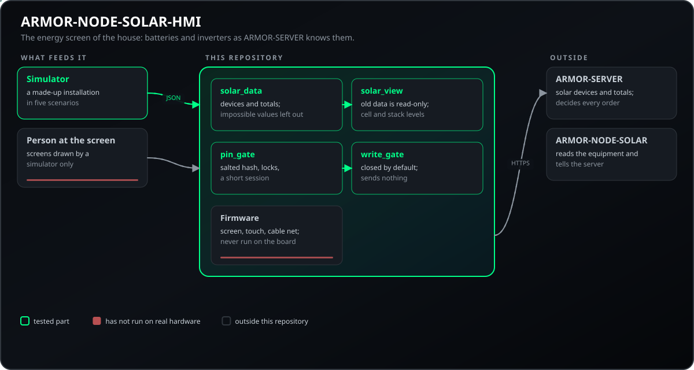

<p align="center">
  
</p>

# 🔋 ARMOR-NODE-SOLAR-HMI

<p align="center">
  <a href="README.md">🇺🇸 English</a> |
  <a href="README_spa.md">🇪🇸 Español</a> |
  <a href="README_fra.md">🇫🇷 Français</a> |
  <a href="README_ita.md">🇮🇹 Italiano</a> |
  <a href="README_deu.md">🇩🇪 Deutsch</a> |
  <a href="README_zho.md">🇨🇳 简体中文</a> |
  <a href="README_jpn.md">🇯🇵 日本語</a> |
  🇵🇹 <b>Português</b>
</p>

### O ecrã de energia da casa: um ecrã tátil de 7 polegadas que mostrará as baterias, as suas células e os inversores tal como o ARMOR-SERVER os conhece

<p align="center">
  
  
  
  
  
  
</p>

---

**Verificação de honestidade - o que funciona hoje:** A lógica do ecrã, um simulador de uma instalação e os ecrãs estão escritos e testados num computador (8 programas de host), e há um firmware para a placa que compila. **Nunca correu numa placa, ainda não há ligação a um servidor e nada aqui envia ordens a uma bateria.**

---

## 📋 Num relance

| | |
|---|---|
| Versão | `0.0.2` |
| Maturidade | Estrutura inicial |
| Função | Ecrã tátil solar do A.R.M.O.R. (família: Clients, principal: ARMOR-SERVER) |
| Tecnologia | Núcleo e simulador em C++17, CMake; verificações em Python |
| Testes | 8 programas de host |
| Placa | Guition JC1060P470C (ESP32-P4 com ESP32-C6, 7 polegadas, 1024 x 600); código que compila, nunca executado nela |
| Funciona em | Um computador com CMake, um compilador C++17 e Python 3.11+ |
| Em hardware real | Nada correu na placa |
| Licença | GPL-3.0-or-later |

**Ir para:** [Visão geral](#-visão-geral) · [Arquitetura](#-arquitetura) · [Funcionalidades](#-funcionalidades) · [Segurança](#-segurança-e-proteção) · [Início rápido](#-início-rápido) · [Testes](#-testes) · [Estrutura](#-estrutura-do-repositório) · [Relacionados](#-projetos-relacionados)

## 🚦 Estado do projeto

Cada linha é uma parte deste repositório e a luz diz até onde chega hoje. É escrita com o que o repositório consegue demonstrar (testes, compilações, execuções), não com o que está previsto.

🟢 Feito e verificado · 🟡 Funciona, com limites conhecidos · 🟠 Feito a meio ou ainda por verificar · 🔴 Por fazer ou a não funcionar

| Área | Estado | O que significa aqui |
|---|---|---|
| Software | 🟠 | Núcleo, ecrãs e um primeiro firmware escritos; sem ligação ao servidor. |
| Testes | 🟡 | Programas de host e duas verificações face ao ARMOR-COMMON; fase inicial. |
| Interface | 🟠 | Os ecrãs são desenhados por um simulador no computador; nunca no painel. |
| Hardware | 🔴 | O firmware compila; nada correu na placa. |
| Segurança | 🟠 | O PIN e a verificação de escrita são apenas lógica testada; sem revisão independente. |
| Atualizações | 🔴 | Ainda não há nada para atualizar. |
| Integração | 🔴 | Uma ligação de leitura é experimentada no computador com o simulador; o firmware ainda não a usa. |
| Documentação | 🟡 | README em oito línguas e a nota de conceção. |

## 🎯 Visão geral

* Mostra a parte de energia de uma instalação: totais, baterias, células e inversores.
* Lê tudo do servidor pela rede; não tem cabo série nem de bateria.
* Passa a só de leitura, e di-lo, quando os dados são antigos.

## 🧩 Papel no A.R.M.O.R.

O [ARMOR-NODE-SOLAR](https://github.com/JuanenRac/ARMOR-NODE-SOLAR) lê os equipamentos, o [ARMOR-SERVER](https://github.com/JuanenRac/ARMOR-SERVER) guarda o que eles dizem e decide cada ordem, e este ecrã mostra-o. O [ARMOR-NODE-HMI](https://github.com/JuanenRac/ARMOR-NODE-HMI) é o painel de todo o sistema; este é só de energia.

## 🏛️ Arquitetura

<p align="center">
  
</p>

## ✨ Funcionalidades

* Um valor em falta ou impossível não é mostrado, nunca como zero.
* Células, módulos e baterias têm um nível com ícone e palavra; só um alarme pisca, no máximo duas vezes por segundo.
* PIN guardado como hash com sal, com bloqueios crescentes e sessão curta.
* Uma operação na bateria só é proposta se o servidor permitir, os dados forem recentes, o PIN estiver aberto e a pessoa tiver confirmado.
* Quem fez o equipamento e o que a bateria diz em três níveis: aviso, proteção e falha da eletrónica, a vermelho fixo.
* Simulador com seis cenários, verificado face aos esquemas das mensagens.
* Ecrãs a 1024 x 600 em oito línguas, desenhados no computador com o mesmo código do firmware.
* Ecrã de verificação para o primeiro dia: chip, memória, painel, toque, I2C, rede por cabo, barras de cor e cantos.

## 🔒 Segurança e proteção

| Ameaça | Defesa |
|---|---|
| Alguém adivinha o PIN | Bloqueios crescentes que sobrevivem a um reinício; sessão curta que acaba sem toques |
| Agir sobre dados antigos | Sem uma resposta recente o ecrã só lê e não propõe operações |
| A flash é lida | Um PIN curto não resiste: a placa terá de cifrar a flash; o servidor continua a decidir cada ordem |

## 🚀 Início rápido

**Requisitos:** CMake 3.16+, um compilador C++17 e Python 3.11+.

```powershell
python tools/armor_project_tool.py build-test .  # os testes de host (precisa de CMake e de um compilador C++17)
build/host/solar_sim cell-high                   # uma resposta do simulador
```

## 🧪 Testes

```powershell
python tools/armor_project_tool.py build-test .
python -I tools/armor_ci_validate.py
```

| Ficheiro | O que cobre |
|---|---|
| `test_solar_data.cpp` | o que se lê e o que se descarta |
| `test_solar_view.cpp` | dados antigos, níveis, intermitência |
| `test_pin_gate.cpp` | hash do PIN, bloqueios, sessão |
| `test_write_gate.cpp` | cada motivo que impede uma operação |
| `test_plant.cpp` | os seis cenários |
| `test_screen_text.cpp` | cada texto nas oito línguas |
| `test_server_link.cpp` | a leitura do servidor: cortes, recusas |
| `test_screen_model.cpp` | alarmes listados, números, pinos |
| `check_font_glyphs.py` | os tipos de letra têm cada carácter |
| `check_simulator.py` | o simulador cumpre os esquemas |
| `check_base_copies.py` | os ficheiros partilhados coincidem com a origem |

## 🏗️ Compilação e publicação

A primeira release traz um ficheiro por variante (revisão do ecrã e do chip), compilado no GitHub Actions e gravado no endereço 0 com `esptool`. **Não testada em hardware: nunca correu numa placa.** O workflow `Screen pictures (simulator)` desenha os ecrãs.

## 📂 Estrutura do repositório

<p align="center">
  
</p>

<details>
<summary>Versão em texto da árvore</summary>

```text
ARMOR-NODE-SOLAR-HMI/
├── core/
│   ├── solar_data.hpp      o que se lê do servidor
│   ├── solar_view.hpp      dados antigos, níveis, intermitência
│   ├── pin_gate.hpp        o PIN do ecrã
│   ├── write_gate.hpp      quando propor uma operação
│   ├── screen_text.hpp     textos em 8 línguas
│   ├── screen_model.hpp    alarmes e números
│   ├── server_link.hpp     lê o servidor (por ligar)
│   ├── board_p4_jc1060.h   pinos da placa
│   ├── json.hpp            da base de firmware comum
│   └── hmac_sha256.hpp     da base de firmware comum
├── main/
│   ├── ui.cpp              as páginas solares
│   ├── diag_ui.cpp         verificação da placa
│   ├── board.c             ecrã, toque, rede
│   ├── app_main.cpp        arranque e registo
│   └── fonts/              tipos de letra
├── simulator/
│   ├── plant.hpp           seis cenários
│   ├── main.cpp            imprime as respostas
│   └── screens/            imagens no PC
├── tests/                  testes de host e de contrato
├── docs/                   conceção e fontes das figuras
├── CMakeLists.txt          projeto do firmware
├── sdkconfig.defaults      definições de build
├── partitions.csv          mapa da flash
├── variants/               outro chip ou painel
├── tools/                  verificações comuns
├── images/                 imagens dos README
├── .github/                workflows e formulários
├── armor.project.json      manifesto
├── CHANGELOG.md            alterações
├── LICENSE                 GPL-3.0-or-later
├── CONTRIBUTING.md         como contribuir
├── CODE_OF_CONDUCT.md      código de conduta
├── SECURITY.md             comunicar vulnerabilidades
└── SUPPORT.md              obter ajuda
```

</details>

## 🗺️ Roteiro e limites conhecidos

**Limites conhecidos hoje**

* **O que faz**: Lê a resposta solar do servidor, avalia-a, protege o PIN, desenha os ecrãs no computador e compila um firmware para a placa.
* **O que não faz**: Ligar-se a um servidor ou ao Wi-Fi, atualizar-se, enviar uma ordem ou correr na placa (nunca tentado).

**A seguir**

* O primeiro arranque na placa com o ecrã de verificação.
* O início de sessão da conta do painel e a ligação de leitura no firmware.
* Wi-Fi pelo ESP32-C6, definições na flash e atualizações.
* A camada de placa partilhada com o ARMOR-NODE-HMI.

## 🌍 Idiomas

O README e os textos existem em inglês, espanhol, francês, italiano, alemão, chinês, japonês e português europeu.

## 🔗 Projetos relacionados

O **A.R.M.O.R.** (Autonomous Radar & Multimodal Observation Range) é um sistema de segurança perimetral feito de repositórios independentes. Cada um tem a sua própria versão, os seus próprios testes e o seu próprio README; esta é a família:

* **[ARMOR-COMMON](https://github.com/JuanenRac/ARMOR-COMMON)** - Contratos de mensagens, validadores, vetores de conformidade e tipos gerados
* **[ARMOR-NODE-RADAR](https://github.com/JuanenRac/ARMOR-NODE-RADAR)** - Firmware de nó de campo para ESP32-S3 com três radares e o seu próprio painel web
* **[ARMOR-NODE-SOLAR](https://github.com/JuanenRac/ARMOR-NODE-SOLAR)** - Protocolos de inversores e baterias solares e as mensagens de um nó porta de ligação
* **[ARMOR-NODE-ELECTRICAL](https://github.com/JuanenRac/ARMOR-NODE-ELECTRICAL)** - Nó elétrico: contadores, a mensagem das leituras da rede e as regras de comutação
* **[ARMOR-NODE-ALARM](https://github.com/JuanenRac/ARMOR-NODE-ALARM)** - Nó e painel de alarme: zonas, armar, atrasos, sirene e PIN, com o servidor ou sem ele
* **[ARMOR-NODE-HMI](https://github.com/JuanenRac/ARMOR-NODE-HMI)** - Painel tátil: o estado do sistema num ecrã de parede, armar e reconhecer, e a casa do assistente de voz
* **ARMOR-NODE-SOLAR-HMI** (este repositório) - Ecrã tátil solar: as baterias e os inversores tal como o ARMOR-SERVER os conhece (fase inicial: ainda sem firmware)
* **[ARMOR-NETWORK](https://github.com/JuanenRac/ARMOR-NETWORK)** - A rede local: os seus dispositivos, a internet e o que muda
* **[ARMOR-SERVER](https://github.com/JuanenRac/ARMOR-SERVER)** - Coordenador central: telemetria, alarmes, dispositivos, leituras solares e câmaras
* **[ARMOR-STUDIO](https://github.com/JuanenRac/ARMOR-STUDIO)** - Consola web: câmaras, radar, alarmes, energia solar e o desenhador 2D/3D do local
* **[ARMOR-ANDROID-CONTROL](https://github.com/JuanenRac/ARMOR-ANDROID-CONTROL)** - Cliente de operador Android com radar 2D/3D em direto
* **[ARMOR-IOS-CONTROL](https://github.com/JuanenRac/ARMOR-IOS-CONTROL)** - Cliente de operador para iPhone
* **[ARMOR-WATCH](https://github.com/JuanenRac/ARMOR-WATCH)** - Cliente de relógio mínimo: avisos de alarme e confirmação de alarme
* **[ARMOR-SERVER-AI](https://github.com/JuanenRac/ARMOR-SERVER-AI)** - Política de inferência visual que explica as suas decisões e nunca atua
* **[ARMOR-VISION](https://github.com/JuanenRac/ARMOR-VISION)** - Zonas de câmara, máscaras e regras de deteção para o Jetson Orin NX
* **[ARMOR-VOICE-AI](https://github.com/JuanenRac/ARMOR-VOICE-AI)** - Intenções de voz offline com uma confirmação que não pode ser falsificada
* **[ARMOR-HARDWARE](https://github.com/JuanenRac/ARMOR-HARDWARE)** - Caixas, eletrónica e a matriz de aceitação em bancada
* **[ARMOR-DEVOPS](https://github.com/JuanenRac/ARMOR-DEVOPS)** - Implantação, a bancada de testes do CM5, cópias de segurança e TLS
* **[ARMOR-SIMULATOR](https://github.com/JuanenRac/ARMOR-SIMULATOR)** - Simulador de telemetria offline com falhas repetíveis
* **[ARMOR-UPDATER](https://github.com/JuanenRac/ARMOR-UPDATER)** - Deteta, instala e atualiza os repositórios do próprio ecossistema
* **[ARMOR-DOCS](https://github.com/JuanenRac/ARMOR-DOCS)** - Arquitetura, base de segurança e a matriz de capacidades

## 📚 Documentação

* [Conceção](docs/DESIGN.md): as regras e o plano
* [Matriz de capacidades: o que está demonstrado e o que não está](https://github.com/JuanenRac/ARMOR-DOCS/blob/main/docs/CAPABILITY_MATRIX.md)
* [Catálogo de projetos: versões e como os repositórios dependem uns dos outros](https://github.com/JuanenRac/ARMOR-DOCS/blob/main/docs/PROJECT_CATALOG.md)
* [Registo de alterações deste repositório](CHANGELOG.md)

## 🤝 Contribuir e comunidade

* Antes de um pull request execute `python tools/armor_project_tool.py build-test .` e `python -I tools/armor_ci_validate.py`: ambos têm de passar. Consulte [CONTRIBUTING.md](CONTRIBUTING.md) e o [código de conduta](CODE_OF_CONDUCT.md).
* O README existe em oito idiomas e é gerado a partir das fontes do ARMOR-DOCS: uma alteração ao texto faz-se lá.
* Uma alteração a uma mensagem entre componentes começa no ARMOR-COMMON.
* Não descreva como a funcionar numa placa aquilo que só foi compilado.
* Comunique uma vulnerabilidade em privado: [SECURITY.md](SECURITY.md). Perguntas, ideias e relatórios: electrohobby3d@gmail.com ([SUPPORT.md](SUPPORT.md)).

## 👤 AUTOR

**JuanenRac (Electro Hobby 3D)** · electrohobby3d@gmail.com

## 📜 LICENÇA

GPL-3.0-or-later - consulte [LICENSE](LICENSE).
