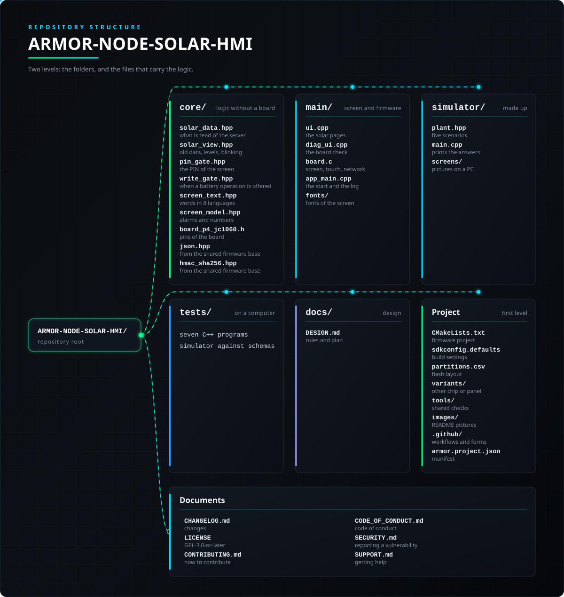

<p align="center">
  
</p>

# 🔋 ARMOR-NODE-SOLAR-HMI

<p align="center">
  <a href="README.md">🇺🇸 English</a> |
  🇪🇸 <b>Español</b> |
  <a href="README_fra.md">🇫🇷 Français</a> |
  <a href="README_ita.md">🇮🇹 Italiano</a> |
  <a href="README_deu.md">🇩🇪 Deutsch</a> |
  <a href="README_zho.md">🇨🇳 简体中文</a> |
  <a href="README_jpn.md">🇯🇵 日本語</a> |
  <a href="README_por.md">🇵🇹 Português</a>
</p>

### La pantalla de energía de la casa: una pantalla táctil de 7 pulgadas que mostrará las baterías, sus celdas y los inversores tal como los conoce ARMOR-SERVER

<p align="center">
  
  
  
  
  
  
</p>

---

**Comprobación de honestidad - qué funciona hoy:** La lógica de la pantalla y un simulador de una instalación están escritos y probados en un ordenador (5 programas de host). **Todavía no hay firmware, ni pantallas, ni conexión con un servidor; nada de aquí envía órdenes a una batería y nada ha corrido en una placa.**

---

## 📋 De un vistazo

| | |
|---|---|
| Versión | `0.0.1` |
| Madurez | Andamiaje |
| Función | Pantalla táctil solar de A.R.M.O.R. (familia: Clients, padre: ARMOR-SERVER) |
| Tecnología | Núcleo y simulador en C++17, CMake; comprobaciones en Python |
| Pruebas | 5 programas de host |
| Placa | Guition JC1060P470C (ESP32-P4 con ESP32-C6, 7 pulgadas, 1024 x 600); aún sin código de placa |
| Funciona en | Un ordenador con CMake, un compilador C++17 y Python 3.11+ |
| En hardware real | Nada ha corrido en la placa |
| Licencia | GPL-3.0-or-later |

**Ir a:** [Resumen](#-resumen) · [Arquitectura](#-arquitectura) · [Funciones](#-funciones) · [Seguridad](#-seguridad-y-protección) · [Inicio rápido](#-inicio-rápido) · [Pruebas](#-pruebas) · [Estructura](#-estructura-del-repositorio) · [Relacionados](#-proyectos-relacionados)

## 🚦 Estado del proyecto

Cada línea es una parte de este repositorio y la luz dice hasta dónde llega hoy. Está escrito con lo que el repositorio puede demostrar (pruebas, compilaciones, ejecuciones), no con lo que está planeado.

🟢 Hecho y verificado · 🟡 Funciona, con límites conocidos · 🟠 Parcial o sin verificar todavía · 🔴 No hecho o no funciona

| Área | Estado | Qué significa aquí |
|---|---|---|
| Software | 🟠 | El núcleo que lee, juzga y protege está escrito; el firmware no. |
| Pruebas | 🟡 | Programas de host y dos comprobaciones contra ARMOR-COMMON; fase inicial. |
| Interfaz | 🔴 | Todavía no se dibuja ninguna pantalla. |
| Hardware | 🔴 | La placa no tiene código y nada ha corrido en ella. |
| Seguridad | 🟠 | El PIN y la compuerta de escritura son solo lógica probada; sin revisión independiente. |
| Actualizaciones | 🔴 | Todavía no hay nada que actualizar. |
| Integración | 🔴 | Aún sin enlace con ARMOR-SERVER; la ruta solar compacta que necesita no existe. |
| Documentación | 🟡 | README en ocho idiomas y la nota de diseño. |

## 🎯 Resumen

* Muestra la parte de energía de una instalación: totales, baterías, celdas e inversores.
* Lo lee todo del servidor por la red; no tiene cable serie ni de batería.
* Pasa a solo lectura, y lo dice, cuando los datos son antiguos.

## 🧩 Papel en A.R.M.O.R.

[ARMOR-NODE-SOLAR](https://github.com/JuanenRac/ARMOR-NODE-SOLAR) lee los equipos, [ARMOR-SERVER](https://github.com/JuanenRac/ARMOR-SERVER) guarda lo que dicen y decide cada orden, y esta pantalla lo muestra. [ARMOR-NODE-HMI](https://github.com/JuanenRac/ARMOR-NODE-HMI) es el panel de todo el sistema; este es solo de energía.

## 🏛️ Arquitectura

<p align="center">
  
</p>

## ✨ Funciones

* Un valor que falta o es imposible no se muestra, nunca como cero.
* Celdas, módulos y baterías tienen un nivel con icono y palabra; solo parpadea una alarma, como mucho dos veces por segundo.
* PIN guardado como hash con sal, con bloqueos crecientes y sesión corta.
* Una operación de batería solo se ofrece si el servidor lo permite, los datos son recientes, el PIN está abierto y la persona ha confirmado.
* Simulador con cinco escenarios, comprobado contra los esquemas de los mensajes.

## 🔒 Seguridad y protección

| Amenaza | Defensa |
|---|---|
| Alguien adivina el PIN | Bloqueos crecientes que sobreviven a un reinicio; sesión corta que acaba sin toques |
| Se actúa con datos antiguos | Sin respuesta reciente la pantalla solo lee y no ofrece operaciones |
| Alguien lee la flash | Un PIN corto no resiste eso: la placa tendrá que cifrar su flash; el servidor sigue decidiendo cada orden |

## 🚀 Inicio rápido

**Requisitos:** CMake 3.16+, un compilador C++17 y Python 3.11+.

```powershell
python tools/armor_project_tool.py build-test .  # las pruebas de host (necesita CMake y un compilador C++17)
build/host/solar_sim cell-high                   # una respuesta del simulador
```

## 🧪 Pruebas

```powershell
python tools/armor_project_tool.py build-test .
python -I tools/armor_ci_validate.py
```

| Fichero | Qué cubre |
|---|---|
| `test_solar_data.cpp` | qué se lee y qué se descarta |
| `test_solar_view.cpp` | datos antiguos, niveles, parpadeo |
| `test_pin_gate.cpp` | hash del PIN, bloqueos, sesión |
| `test_write_gate.cpp` | cada motivo que impide una operación |
| `test_plant.cpp` | los cinco escenarios |
| `check_simulator.py` | el simulador cumple los esquemas |
| `check_base_copies.py` | los ficheros compartidos coinciden con su origen |

## 🏗️ Compilación y publicación

Todavía no hay firmware que compilar ni release. Cuando lo haya, se compilará solo en GitHub Actions.

## 📂 Estructura del repositorio

<p align="center">
  
</p>

<details>
<summary>Versión en texto del árbol</summary>

```text
ARMOR-NODE-SOLAR-HMI/
├── core/
│   ├── solar_data.hpp    lo que se lee del servidor
│   ├── solar_view.hpp    datos antiguos, niveles, parpadeo
│   ├── pin_gate.hpp      el PIN de la pantalla
│   ├── write_gate.hpp    cuándo se ofrece operar una batería
│   ├── json.hpp          de la base de firmware común
│   └── hmac_sha256.hpp   de la base de firmware común
├── simulator/
│   ├── plant.hpp         cinco escenarios
│   └── main.cpp          imprime las respuestas
├── tests/                pruebas de host y de contrato
├── docs/                 diseño y fuentes de figuras
├── tools/                comprobaciones comunes
├── images/               figuras de los README
├── .github/              flujos y formularios
├── armor.project.json    manifiesto
├── CHANGELOG.md          cambios
├── LICENSE               GPL-3.0-or-later
├── CONTRIBUTING.md       cómo contribuir
├── CODE_OF_CONDUCT.md    código de conducta
├── SECURITY.md           informar de fallos de seguridad
└── SUPPORT.md            pedir ayuda
```

</details>

## 🗺️ Hoja de ruta y límites conocidos

**Límites conocidos hoy**

* **Qué hace**: Lee la respuesta solar del servidor, juzga lo que dice y protege el PIN, en un ordenador.
* **Qué no hace**: Dibujar una pantalla, conectarse a nada, enviar una orden ni correr en la placa.

**Lo siguiente**

* Una respuesta solar compacta en ARMOR-SERVER para pantallas pequeñas, definida antes en ARMOR-COMMON.
* Las pantallas a 1024 x 600 dibujadas por un simulador en el ordenador, en ocho idiomas.
* La capa de placa compartida con ARMOR-NODE-HMI.
* El primer encendido en la placa.

## 🌍 Idiomas

El README y los textos existen en inglés, español, francés, italiano, alemán, chino, japonés y portugués de Portugal.

## 🔗 Proyectos relacionados

**A.R.M.O.R.** (Autonomous Radar & Multimodal Observation Range) es un sistema de seguridad perimetral hecho de repositorios independientes. Cada uno tiene su propia versión, sus propias pruebas y su propio README; esta es la familia:

* **[ARMOR-COMMON](https://github.com/JuanenRac/ARMOR-COMMON)** - Contratos de mensajes, validadores, vectores de conformidad y tipos generados
* **[ARMOR-NODE-RADAR](https://github.com/JuanenRac/ARMOR-NODE-RADAR)** - Firmware de nodo de campo para ESP32-S3 con tres radares y su propio panel web
* **[ARMOR-NODE-SOLAR](https://github.com/JuanenRac/ARMOR-NODE-SOLAR)** - Protocolos de inversores y baterías solares y los mensajes de un nodo pasarela
* **[ARMOR-NODE-ELECTRICAL](https://github.com/JuanenRac/ARMOR-NODE-ELECTRICAL)** - Nodo eléctrico: medidores, el mensaje de las lecturas de la red y las reglas de maniobra
* **[ARMOR-NODE-ALARM](https://github.com/JuanenRac/ARMOR-NODE-ALARM)** - Nodo y panel de alarma: zonas, armado, retardos, sirena y PIN, con el servidor o sin él
* **[ARMOR-NODE-HMI](https://github.com/JuanenRac/ARMOR-NODE-HMI)** - Panel táctil: el estado del sistema en una pantalla de pared, armar y reconocer, y el hogar del asistente de voz
* **ARMOR-NODE-SOLAR-HMI** (este repositorio) - Pantalla táctil solar: las baterías y los inversores tal como los conoce ARMOR-SERVER (fase inicial: aún sin firmware)
* **[ARMOR-NETWORK](https://github.com/JuanenRac/ARMOR-NETWORK)** - La red local: sus dispositivos, internet y lo que cambia
* **[ARMOR-SERVER](https://github.com/JuanenRac/ARMOR-SERVER)** - Coordinador central: telemetría, alarmas, dispositivos, lecturas solares y cámaras
* **[ARMOR-STUDIO](https://github.com/JuanenRac/ARMOR-STUDIO)** - Consola web: cámaras, radar, alarmas, energía solar y el diseñador 2D/3D del emplazamiento
* **[ARMOR-ANDROID-CONTROL](https://github.com/JuanenRac/ARMOR-ANDROID-CONTROL)** - Cliente de operador Android con radar 2D/3D en vivo
* **[ARMOR-IOS-CONTROL](https://github.com/JuanenRac/ARMOR-IOS-CONTROL)** - Cliente de operador para iPhone
* **[ARMOR-WATCH](https://github.com/JuanenRac/ARMOR-WATCH)** - Cliente de reloj mínimo: avisos de alarma y confirmación de alarma
* **[ARMOR-SERVER-AI](https://github.com/JuanenRac/ARMOR-SERVER-AI)** - Política de inferencia visual que explica sus decisiones y nunca actúa
* **[ARMOR-VISION](https://github.com/JuanenRac/ARMOR-VISION)** - Zonas de cámara, máscaras y reglas de detección para la Jetson Orin NX
* **[ARMOR-VOICE-AI](https://github.com/JuanenRac/ARMOR-VOICE-AI)** - Intenciones de voz sin conexión con una confirmación que no se puede falsificar
* **[ARMOR-HARDWARE](https://github.com/JuanenRac/ARMOR-HARDWARE)** - Cajas, electrónica y la matriz de aceptación en banco
* **[ARMOR-DEVOPS](https://github.com/JuanenRac/ARMOR-DEVOPS)** - Despliegue, el banco de pruebas de la CM5, copias de seguridad y TLS
* **[ARMOR-SIMULATOR](https://github.com/JuanenRac/ARMOR-SIMULATOR)** - Simulador de telemetría sin conexión con fallos repetibles
* **[ARMOR-UPDATER](https://github.com/JuanenRac/ARMOR-UPDATER)** - Detecta, instala y actualiza los repositorios del propio ecosistema
* **[ARMOR-DOCS](https://github.com/JuanenRac/ARMOR-DOCS)** - Arquitectura, base de seguridad y la matriz de capacidades

## 📚 Documentación

* [Diseño](docs/DESIGN.md): las reglas y el plan
* [Matriz de capacidades: qué está demostrado y qué no](https://github.com/JuanenRac/ARMOR-DOCS/blob/main/docs/CAPABILITY_MATRIX.md)
* [Catálogo de proyectos: versiones y cómo dependen unos repositorios de otros](https://github.com/JuanenRac/ARMOR-DOCS/blob/main/docs/PROJECT_CATALOG.md)
* [Registro de cambios de este repositorio](CHANGELOG.md)

## 🤝 Contribuir y comunidad

* Antes de un pull request ejecuta `python tools/armor_project_tool.py build-test .` y `python -I tools/armor_ci_validate.py`: ambos deben pasar. Consulta [CONTRIBUTING.md](CONTRIBUTING.md) y el [código de conducta](CODE_OF_CONDUCT.md).
* El README existe en ocho idiomas y se genera desde las fuentes de ARMOR-DOCS: un cambio de texto se hace allí.
* Un cambio en un mensaje entre componentes empieza en ARMOR-COMMON.
* No describas como funcionando en una placa lo que solo se ha compilado.
* Informa de una vulnerabilidad en privado: [SECURITY.md](SECURITY.md). Preguntas, ideas e informes: electrohobby3d@gmail.com ([SUPPORT.md](SUPPORT.md)).

## 👤 AUTOR

**JuanenRac (Electro Hobby 3D)** · electrohobby3d@gmail.com

## 📜 LICENCIA

GPL-3.0-or-later - véase [LICENSE](LICENSE).
